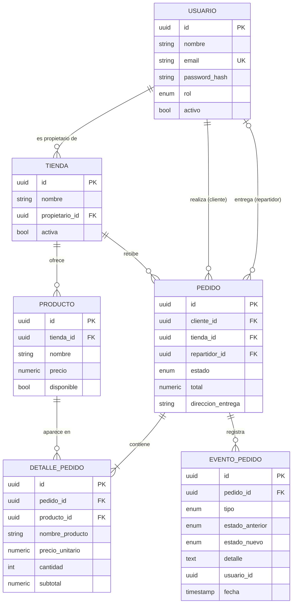
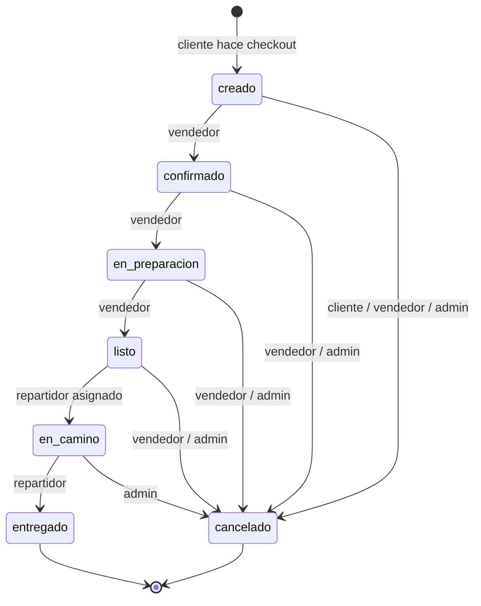
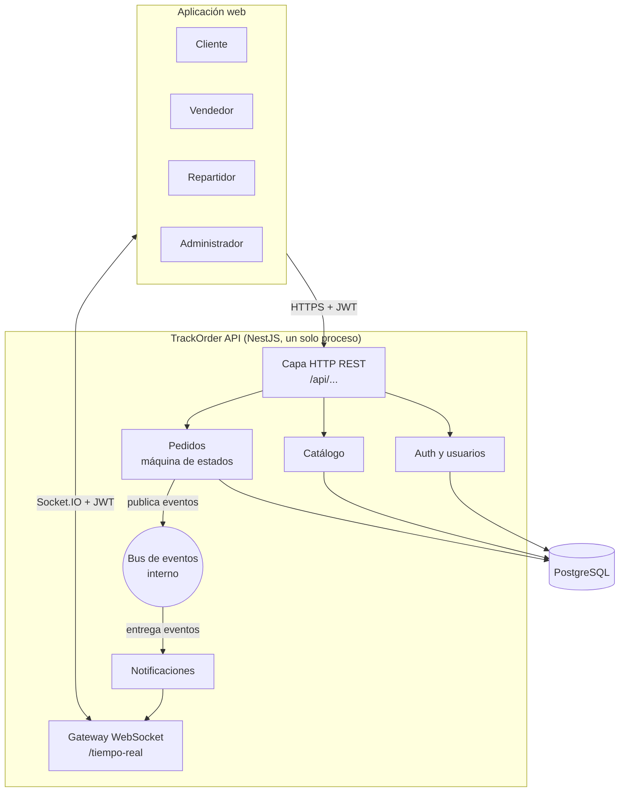
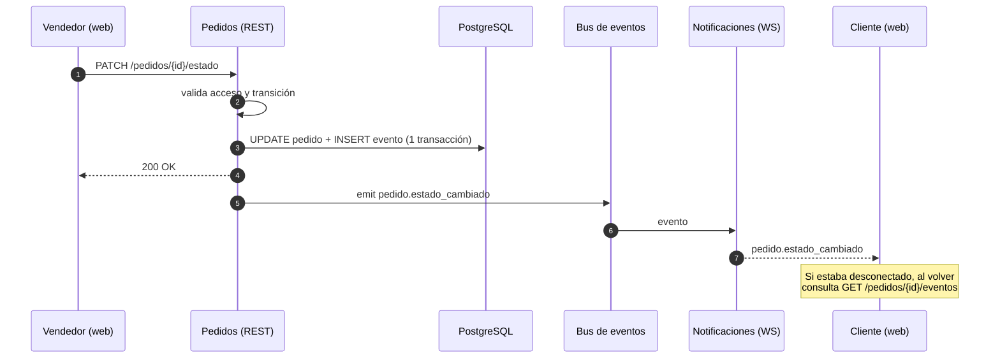

# TrackOrder: primer avance

**Proyecto integrador** · Sistema de gestión y seguimiento de pedidos en tiempo real

| | |
|---|---|
| Integrantes | Angel Barbarin · Diego Valerio · Diego Alvarez |
| Entrega | Primer avance: arquitectura conceptual, definición inicial del sistema y API inicial |
| Repositorio | [https://github.com/DiegoAAH/Proyecto-Integrador-BackEndDev](https://github.com/DiegoAAH/Proyecto-Integrador-BackEndDev) (privado) |

## 1. Definición inicial del sistema

### 1.1 Problema y objetivo

Los negocios pequeños y medianos que venden por internet suelen gestionar sus pedidos en hojas de cálculo o chats. El vendedor pierde trazabilidad del estado de cada pedido y el cliente no sabe en qué va su compra sin preguntar.

**TrackOrder** es una aplicación web que permite a un negocio gestionar su catálogo y sus pedidos, y que muestra a clientes, vendedores y repartidores el estado de cada pedido actualizado en tiempo real, desde que se crea hasta que se entrega.

### 1.2 Usuarios y roles

| Rol | Qué hace en el sistema |
|---|---|
| Cliente | Se registra, navega el catálogo, crea pedidos, sigue su estado en tiempo real y consulta su historial. Puede cancelar un pedido mientras no haya sido confirmado. |
| Vendedor | Administra su tienda y sus productos, recibe pedidos nuevos en tiempo real, los confirma o rechaza, los avanza hasta "listo" y asigna un repartidor. |
| Repartidor | Ve los pedidos que tiene asignados, los marca "en camino" y "entregado", y reporta incidencias. |
| Administrador | Gestiona usuarios y roles, supervisa todos los pedidos y puede cancelar pedidos no cerrados. |

El registro público siempre crea clientes. El administrador asigna los roles de vendedor y repartidor. Al arrancar por primera vez, el sistema crea un administrador inicial con las credenciales definidas en `.env`.

### 1.3 Alcance

**Incluye:** autenticación JWT y autorización por roles; catálogo por tienda; creación de pedidos; flujo de estados con validación; historial de eventos por pedido; notificaciones en tiempo real por WebSocket; paneles de vendedor y repartidor; historial del cliente; despliegue en contenedor.

**No incluye:** pagos reales (se simulan), ruteo o geolocalización de repartidores, app móvil nativa, marketplace multi-vendedor complejo ni facturación.

### 1.4 Modelo de datos



Decisiones del modelo:

- **Detalle de pedido** guarda una copia del nombre y del precio del producto al momento de la compra, para que el pedido no cambie si el vendedor edita el producto después.
- **Evento de pedido** registra cada cambio (creación, cambio de estado, asignación, incidencia) en la misma transacción que el cambio. Es el historial auditable del pedido y la fuente para resincronizar a un usuario que se reconecta.
- Los productos se dan de baja de forma lógica (`disponible = false`) para no romper pedidos anteriores.

### 1.5 Ciclo de vida del pedido



La máquina de estados se implementará como una tabla de transiciones que indique, para cada estado, a qué estados puede pasar y qué rol puede hacerlo. Cualquier transición fuera de esa tabla se rechazará con error 400 (transición inválida) o 403 (rol sin permiso). El repartidor se podrá asignar cuando el pedido esté confirmado, en preparación o listo, y solo el repartidor asignado podrá marcarlo "en camino".

## 2. Arquitectura conceptual

### 2.1 Decisión: monolito modular orientado a eventos

La lógica de negocio gira en torno a un solo agregado central, el **pedido**, y su máquina de estados. Casi todas las operaciones leen y escriben las mismas entidades y necesitan consistencia transaccional, y el tiempo real requiere mantener conexiones WebSocket abiertas. Por eso el sistema es **una sola aplicación desplegable**, dividida en módulos con fronteras claras que se comunican mediante **eventos de dominio**.

Esto reduce la infraestructura a un servicio y una base de datos, permite guardar el cambio de estado y su evento en la misma transacción, mantiene las conexiones WebSocket en memoria sin una tabla de conexiones, y deja todo el sistema ejecutable en local con `docker compose up`.

### 2.2 Vista de componentes



| Módulo | Responsabilidad | Eventos |
|---|---|---|
| Auth y usuarios | Registro, login, emisión y validación de JWT, roles, administración de cuentas. | — |
| Catálogo | Tiendas y productos (alta, edición, baja lógica, consulta pública). | — |
| Pedidos | Checkout, máquina de estados, asignación de repartidor, incidencias, historial. | Publica `pedido.creado`, `pedido.estado_cambiado`, `pedido.asignado`, `pedido.incidencia` |
| Notificaciones | Autentica conexiones WebSocket, las agrupa en salas y entrega cada evento a quien corresponde. | Consume todos los eventos de pedidos |

En este primer avance están implementados los módulos de **auth y usuarios** y de **catálogo**. Los módulos de **pedidos** y **notificaciones** ya están diseñados (sección 1.5 y este apartado) y se implementarán en los siguientes avances.

**Regla de diseño:** un módulo no llama a otro para reaccionar a un cambio; publica un evento. Así el módulo de pedidos no sabe que existe el de notificaciones, y este podría extraerse a un servicio aparte en el futuro sin tocar la lógica de pedidos.

### 2.3 Flujo de un cambio de estado



El evento se publica **después** de confirmar la transacción, para no notificar cambios que no se guardaron. Como cada evento queda persistido en `evento_pedido`, ningún cambio se pierde aunque un usuario esté desconectado en ese momento.

### 2.4 Tecnologías

| Capa | Tecnología | Motivo |
|---|---|---|
| Backend | Node.js 22 + JavaScript + NestJS (compilado con Babel) | Módulos, inyección de dependencias, validación y WebSocket integrados. |
| Tiempo real | Socket.IO | Salas por usuario/tienda/pedido y reconexión automática. |
| Bus de eventos | `@nestjs/event-emitter` (en memoria) | Desacopla módulos sin infraestructura extra; sustituible por Redis o RabbitMQ. |
| Base de datos | PostgreSQL 16 + TypeORM | Transacciones, integridad referencial y enums nativos. |
| Seguridad | JWT, contraseñas con bcrypt, guardias por rol | Autorización declarativa por endpoint. |
| Documentación API | OpenAPI / Swagger | Contrato navegable en `/api/docs`. |
| Infraestructura | Docker y Docker Compose; AWS (contenedor + Amazon RDS) | Mismo entorno en local y en la nube. |

### 2.5 Despliegue

En desarrollo, `docker compose up` levanta PostgreSQL y la API. En producción, la imagen Docker se ejecutará en AWS (Elastic Beanstalk, ECS Fargate o EC2) con Amazon RDS for PostgreSQL, y GitHub Actions ejecutará pruebas, construirá la imagen y desplegará.

### 2.6 Alternativa considerada

Separar el sistema en dos microservicios (pedidos y catálogo por un lado, notificaciones en tiempo real por otro) comunicados mediante un broker. Permite escalar el canal en tiempo real por separado, pero añade un broker, dos despliegues, contratos de eventos versionados y consistencia eventual. Para un equipo de tres personas en un semestre no se justifica al inicio. Como los módulos ya se comunican por eventos, la extracción queda disponible si se necesita.

## 3. API inicial

### 3.1 Convenciones

- URL base: `http://localhost:3000/api`. Documentación interactiva en `/api/docs` y contrato OpenAPI en `docs/openapi.json`.
- Autenticación: encabezado `Authorization: Bearer <accessToken>` obtenido en registro o login.
- Formato: JSON. Los cuerpos se validan; los campos desconocidos se rechazan con 400.
- Errores: `{ "statusCode": 400, "message": "...", "error": "Bad Request" }`. Códigos usados: 400 datos o transición inválida, 401 sin token o token inválido, 403 sin permiso, 404 no encontrado, 409 email ya registrado.

### 3.2 Endpoints implementados

| Método | Ruta | Rol | Descripción |
|---|---|---|---|
| GET | `/health` | Público | Estado del servicio. |
| POST | `/auth/registro` | Público | Crea una cuenta de cliente y devuelve el token. |
| POST | `/auth/login` | Público | Inicia sesión y devuelve el token. |
| GET | `/usuarios/me` | Autenticado | Perfil del usuario actual. |
| GET | `/usuarios?rol=` | Admin, vendedor | Lista usuarios (el vendedor la usará para elegir repartidor). |
| PATCH | `/usuarios/{id}` | Admin | Cambia rol o activa/desactiva una cuenta. |
| GET | `/tiendas` | Público | Lista tiendas activas. |
| POST | `/tiendas` | Vendedor, admin | Crea una tienda. |
| GET | `/tiendas/{id}` | Público | Detalle de una tienda. |
| GET | `/tiendas/{id}/productos` | Público | Catálogo de la tienda (`?todos=true` incluye bajas). |
| POST | `/tiendas/{id}/productos` | Dueño, admin | Agrega un producto. |
| GET | `/productos/{id}` | Público | Detalle de un producto. |
| PATCH | `/productos/{id}` | Dueño, admin | Edita un producto. |
| DELETE | `/productos/{id}` | Dueño, admin | Baja lógica del producto. |

### 3.3 Ejemplos

**Registro** (`POST /api/auth/registro`):

```json
{ "nombre": "Ana López", "email": "ana@correo.com", "password": "Secreta123" }
```

Respuesta `201`:

```json
{
  "accessToken": "eyJhbGciOi…",
  "usuario": { "id": "41c9…", "nombre": "Ana López", "email": "ana@correo.com", "rol": "cliente" }
}
```

**Agregar producto** (`POST /api/tiendas/{id}/productos`, como vendedor dueño de la tienda):

```json
{ "nombre": "Concha de vainilla", "descripcion": "Pieza individual", "precio": 18.5 }
```

Si el usuario no es dueño de la tienda responde `403 No administras esta tienda`; si el precio es negativo o falta el nombre, `400` con el detalle de cada campo.

### 3.4 Endpoints planeados para el siguiente avance

| Método | Ruta | Rol | Descripción |
|---|---|---|---|
| POST | `/pedidos` | Cliente | Checkout: crea el pedido con sus productos. |
| GET | `/pedidos?estado=&activos=` | Autenticado | Pedidos visibles según el rol. |
| GET | `/pedidos/{id}` | Con acceso | Detalle del pedido y estados a los que puede moverlo el usuario. |
| GET | `/pedidos/{id}/eventos` | Con acceso | Línea de tiempo del pedido. |
| PATCH | `/pedidos/{id}/estado` | Según la máquina de estados | Cambia el estado. |
| PATCH | `/pedidos/{id}/repartidor` | Vendedor dueño, admin | Asigna un repartidor. |
| POST | `/pedidos/{id}/incidencias` | Repartidor asignado | Reporta una incidencia. |

El canal en tiempo real usará Socket.IO en el namespace `/tiempo-real`, autenticado con el mismo JWT. Cada usuario quedará en salas según su rol (`usuario:{id}`, `tienda:{id}`, `admins`) y recibirá los eventos `pedido.creado`, `pedido.estado_cambiado`, `pedido.asignado` y `pedido.incidencia` de los pedidos que le corresponden.

## 4. Estado del avance

**Implementado en este avance:**

- Proyecto base con NestJS (JavaScript), PostgreSQL, Docker Compose y Swagger.
- Registro, login, JWT y autorización por rol; administrador inicial automático.
- Catálogo de tiendas y productos con control de propietario y baja lógica.
- Validación de datos de entrada en todos los endpoints.

**Siguientes avances:**

- Pedidos: checkout, máquina de estados, asignación de repartidor, incidencias e historial de eventos.
- Notificaciones en tiempo real con Socket.IO.
- Pruebas unitarias y de integración.
- Interfaz web para cliente, vendedor y repartidor.
- Migraciones de base de datos, pipeline de CI/CD y despliegue en AWS.

## 5. Cómo ejecutar el proyecto

```bash
cp .env.example .env
docker compose up -d db
npm install
npm run start:dev
# API: http://localhost:3000/api · Swagger: http://localhost:3000/api/docs
```
